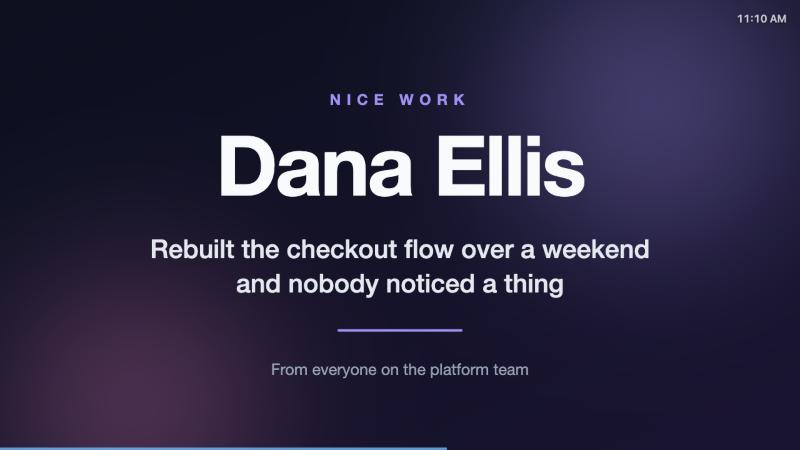
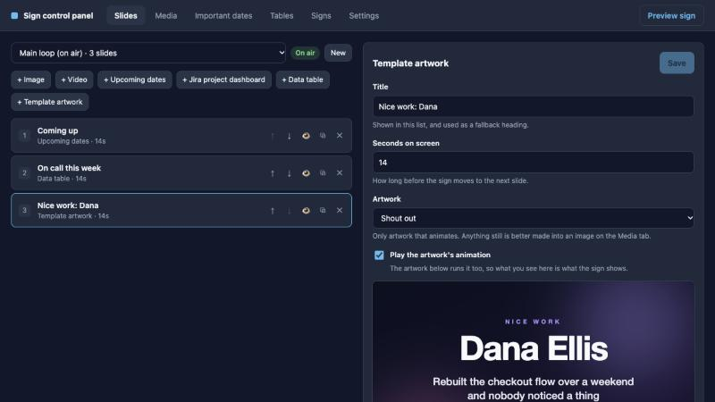
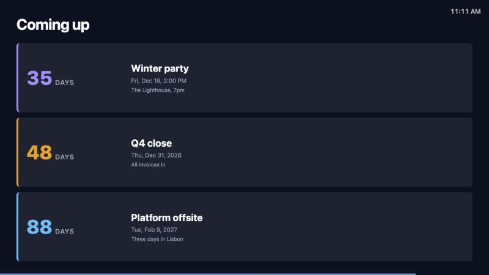
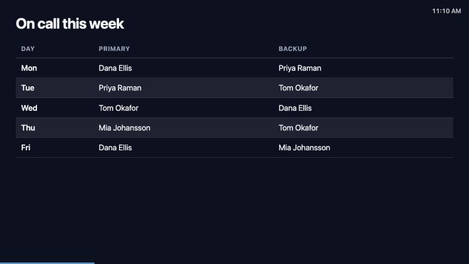

# showbiz

Digital signage slideshow for a BrightSign player, with a web control panel.

The player loads one URL and plays a loop. Everything about that loop — slides,
order, timings, media, Jira boards, countdowns — is edited from a browser and
lands on the sign within about a second, without touching the player.

Touch is supported but never required: with no touchscreen the sign is a plain
autoplaying carousel.

▶ **[Watch the two-minute tour](docs/showbiz-overview.mp4)**, narrated and captioned.



## Quick start

Everything runs in Docker, so there is nothing to install, no database to set
up and no `.env` to write. All you need is Docker with Compose v2.

```bash
git clone https://github.com/jstark518/showbiz.git
```

```bash
cd showbiz && docker compose up -d --build
```

The first run pulls the base images and builds, so give it a few minutes; after
that it starts in seconds. It brings up Postgres, applies the migrations and
seeds an empty playlist called **Main loop**, already on air. Then open two
tabs:

| | |
| --- | --- |
| **Control panel** | <http://localhost:3000/> — where you build the loop |
| **Sign** | <http://localhost:3000/sign> — what a screen shows |

### Put something on the screen

On the panel's **Slides** tab, press **+ Template artwork**. The slide is added
immediately — there is no dialog to fill in — and its editor opens on the right.

Pick anything from **Choose artwork…**; **Shout out** is a good first one. The
artwork draws straight away with its wording in editable boxes beside it, so
change the name and the message to whatever you like and press **Save**.

The panel says *"Saved. The sign updates within a second."* Switch to the sign
tab and it is already there — no reload, nothing to republish. That second is
the whole point of the app: once a screen is pointed at a URL, nobody touches
the player again.

Add a few more slides with the other **+** buttons and they play top to bottom,
then start again.

### When you are done

```bash
docker compose down -v
```

That removes the containers and the data. Leave off `-v` to keep your slides
and uploads for next time.

## What it looks like

The control panel. Slides on the left in playing order, the selected slide's
editor on the right, with a live preview that is the sign's own renderer rather
than a second implementation of it.



The same loop on screen — countdowns to dates kept on the **Important dates**
tab, and a grid maintained by hand on **Tables**.





## Slide types

| Type | What it shows |
| --- | --- |
| **Image** | A still, cover or letterboxed, with an optional caption |
| **Video** | A clip, muted by default, either playing to the end or cut off by the slide timer |
| **Jira project dashboard** | A project, a sprint, one epic in depth, or every epic in a project ranked by health. Built from dropdowns — no JQL required |
| **Upcoming dates** | Countdowns to important dates, in whole days or ticking to the second on the last day |
| **Data table** | A small grid you keep by hand — an on-call rota, a league ladder — edited on the **Tables** tab |

Image and video are built in. The rest are **plugins**: self-contained folders
under `plugins/` that add a slide type and, where it makes sense, a tab of their
own. Removing one is deleting its folder and four lines of registry.

[docs/SLIDE_TYPE_IDEAS.md](docs/SLIDE_TYPE_IDEAS.md) has a backlog of further
types with data sources and config sketches, and
[Writing a plugin](docs/writing-a-plugin.md) has what writing one involves.

## How it works

One container serves both halves. A Fastify server hands out the control panel
at `/` and the sign at `/sign`, backed by Postgres; the player loads one URL and
never needs touching again.

- **Edits land in about a second.** The panel writes, the server broadcasts over
  SSE, and every sign holding that playlist redraws. A once-a-minute poll is the
  backstop, and a `revision` hash means an unchanged poll doesn't restart the loop.
- **The sign must never go blank.** An unreachable server keeps playing the last
  playlist. An unreachable Jira serves its last good answer with a "Cached"
  badge. A misconfigured slide draws a placeholder saying so in plain language.
- **Features are plugins.** Important dates, Jira and data tables live in
  self-contained folders under `plugins/`, each adding its slide type, panel tab
  and routes. Removing one is deleting its folder and four lines of registry.
- **Three Vite entries, one project.** Panel, sign and the preview iframe share
  the wire types, so the panel's tooling never ships to the player.

## Documentation

| | |
| --- | --- |
| [Using the panel](docs/panel.md) | Keeping a table, and making artwork without a designer |
| [Running it](docs/configuration.md) | Ports, credentials, storage, reaching it from other devices |
| [Players and screens](docs/players.md) | Pointing a BrightSign at it, sign addresses, touch |
| [Connecting Jira](docs/jira.md) | Credentials, what a slide can follow, how "At risk" is decided |
| [Deploying to a cluster](docs/cluster.md) | The GitLab pipeline, Kubernetes, MinIO uploads |
| [Development](docs/development.md) | Running it on the host, layout, registries, data model |
| [Writing a plugin](docs/writing-a-plugin.md) | A slide type of your own, start to finish |
| [Writing a template](docs/writing-a-template.md) | Annotating an SVG so the panel can edit it |
| [Security](docs/security.md) | What having no authentication means |
| [Slide type ideas](docs/SLIDE_TYPE_IDEAS.md) | A backlog, with data sources and config sketches |

[CLAUDE.md](CLAUDE.md) covers what is non-obvious when changing the code.
